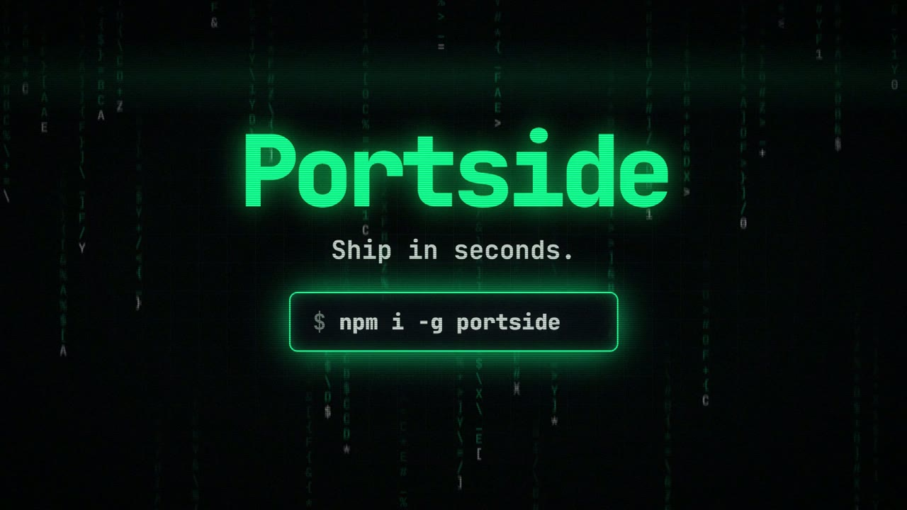
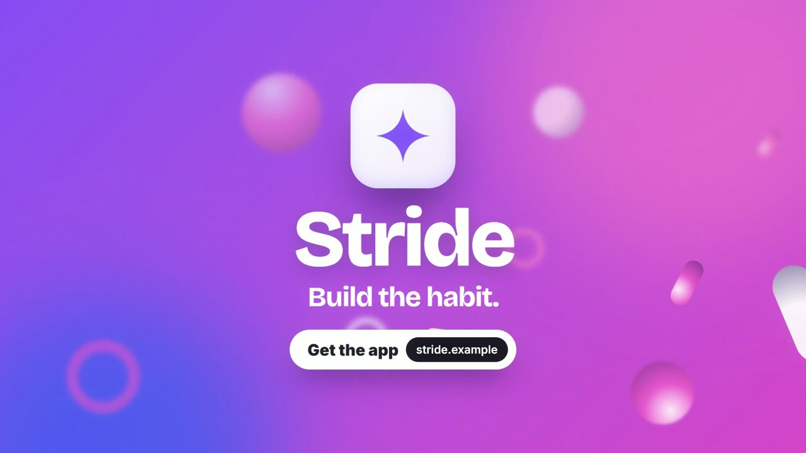

# LaunchFX

Launch videos made by your own coding agent. Give Claude Code, Codex or Cursor your site address; it reads your site, writes the script, voices it, adds music and sound effects, and renders a 1080p MP4 on your machine.

No accounts, no API keys, no per-video cost. Voice, music and effects are all generated locally. One run gives you the 16:9 video plus vertical and square versions with captions for TikTok, Reels, Shorts and feeds.

This repo is the free edition: the full engine and three templates. Watch them with sound at [launchfx.dev](https://launchfx.dev).

| Aurora: SaaS launch | Terminal: developer tools | Pocket: mobile app |
|---|---|---|
| [](https://launchfx.dev) | [](https://launchfx.dev) | [](https://launchfx.dev) |

## Quick start

```
git clone https://github.com/emrahsinekli/launchfx
cd launchfx
```

Open the folder in your agent and say:

> Set up LaunchFX and make a launch video for https://yoursite.com

The agent runs the setup, reads your site, writes the content, shows you a preview and renders the final video to `out/<name>/<name>.mp4`. Claude Code reads the skill in `.claude/skills/launchfx/`; Codex, Cursor and other agents read `AGENTS.md`. Both hold the same instructions.

## What you need

- A coding agent that can run commands in a folder
- Node.js 18+, Python 3.9+, ffmpeg, and Google Chrome (or Edge / Chromium)
- About 1 GB of free disk space. The voice model (about 350 MB) is downloaded once during setup.

Developed and tested on Windows. macOS and Linux have had less testing: please open an issue if something breaks.

## MCP server and launch kits

The folder is also an MCP server, so your assistant gets LaunchFX as tools: `read_site`, `list_templates`, `get_template`, `save_content`, `preview_frames` (it sees the frames and fixes them), `make_video`, `job_status`, plus `list_launch_kits` and `plan_launch`.

- **Claude Code and Cursor**: open this folder; the server is picked up from `.mcp.json` / `.cursor/mcp.json`.
- **Codex, Claude Desktop, Windsurf**: run `node engine/mcp.mjs --config` and paste what it prints.
- **Nothing installed** (ideas, plans and scripts only): add `https://launchfx.dev/mcp` as a remote MCP server or Claude connector.

A launch kit is a plan for a whole launch: which video to post on which day, how it opens and which facts are needed. There are nine (launch week, developer tool, mobile app, AI product, feature release, offer and sale, year in review, always-on ads, company news). Say:

> Plan my launch for 8 December and make every video

Kits use templates from the whole catalogue; the plan tells you which ones are in the free edition and which are in the all-access pack.

## Studio

```
node engine/studio.mjs
```

Opens a page in your browser: the video plays with voice, music and effects before anything is rendered, every word, number and colour is a field you can change, and the render starts with a button.

## By hand

```
node engine/setup.mjs
node engine/brand.mjs https://yoursite.com
node engine/make.mjs 001-aurora templates/001-aurora/content.json --draft
```

`brand.mjs` opens your real site and saves your name, tagline, brand colours, logo, the numbers on your page and screenshots and a recording of the page scrolling into `projects/<name>/`. Copy a template's `content.json` there, change the values (each template has a `GUIDE.md`), and run `make.mjs` on your copy. Drop `--draft` for the final 60 fps render with motion blur. Add `--social` to also get a vertical (9:16) and a square (1:1) version with word-by-word captions.

## How it works

- A template is one HTML file that draws any moment of the video on request, so every frame is exact and repeatable.
- `engine/render.mjs` steps through it in headless Chrome, four sub-frames per frame for real motion blur, then adds bloom and grain with ffmpeg.
- `engine/tts.py` speaks the lines with the Kokoro voice model, on your machine. English (US and UK), Spanish, French, Italian and Portuguese.
- `engine/audio.py` synthesises the music and every sound effect on the beat grid of the template and ducks them under the voice.

## More templates

Twenty-one more, each with its own look, structure and soundtrack (newspaper front page, 8-bit arcade, film trailer, blueprint, comic page, slot machine, isometric 3D chart and others), are at [launchfx.dev](https://launchfx.dev). They drop into the `templates` folder of this repo.

## Contact

hello@launchfx.dev, or [@dev_emrah](https://x.com/dev_emrah) on X.

## Licence

MIT for everything in this repo. The videos you make are yours.
